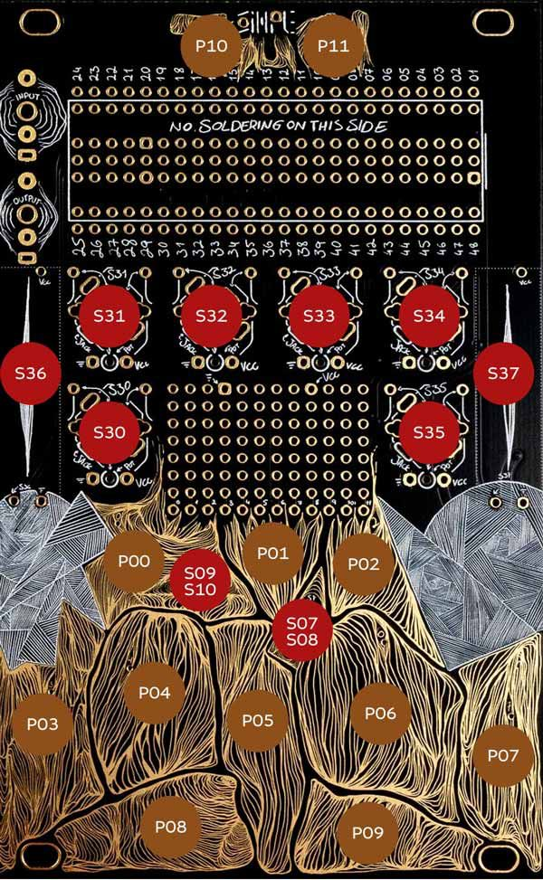

# THIS IS SIMPLE FX

## CONTROLS


**Switches**
- S07-S08 - momentary / latch

**Knobs**
- S30 - delay mix
- S31 - delay feedback
- S32 - delay modulation speed
- S33 - delay modulation amount
- S34 - reverb send
- S35 - reverb mix
- S35 + P0 - drive A post volume
- S35 + P3 - drive B post volume
- S35 + P4 - drive C post volume
- S35 + P2 - bit crush A post volume
- S35 + P6 - bit crush B post volume
- S35 + P7 - bit crush C post volume
- S36 - delay time
- S37 - reverb size

**Pads**
- P0 - drive A
- P3 - drive B
- P4 - drive C
- P2 - bit crush A
- P6 - bit crush B
- P7 - bit crush C
- P5 - bypass
- P8 - delay bypass
- P9 - reverb bypass

## PROJECT SETUP
```shell
$ git clone --recurse-submodules https://github.com/Synthux-Academy/TouchFX.git
$ make libs
$ make
```

## UPLOAD
```shell
$ make program-dfu
```
